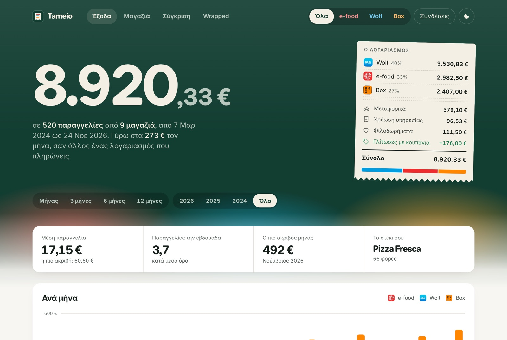
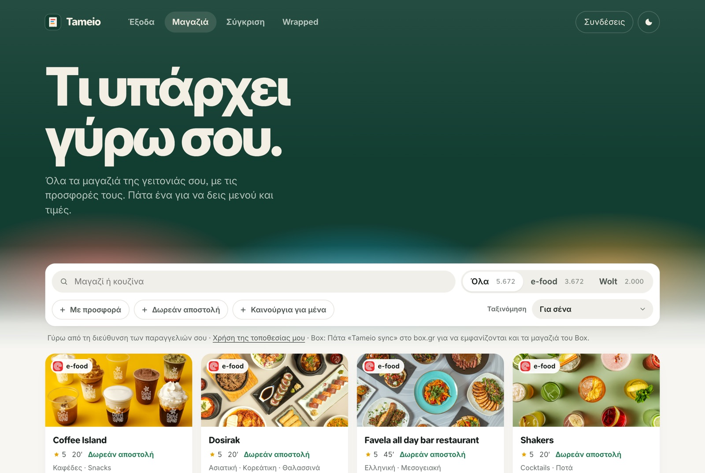
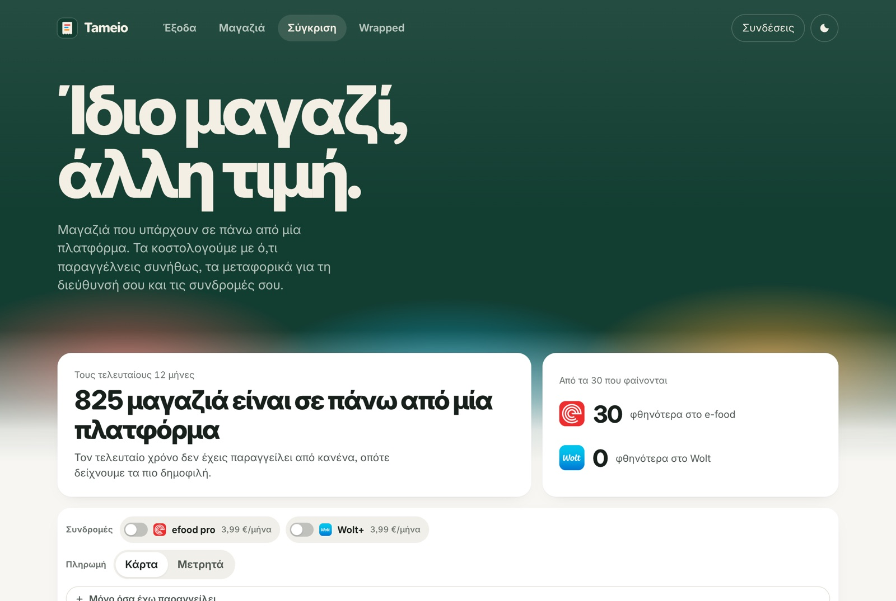
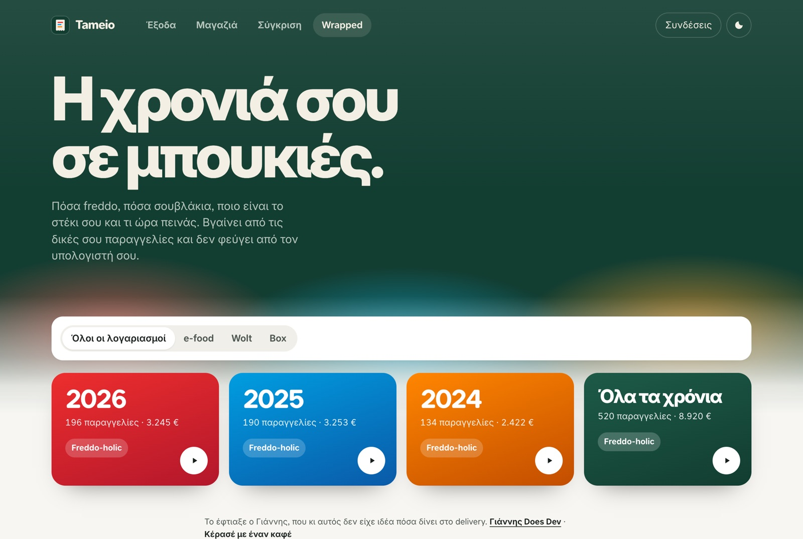

<div align="center">


# Tameio

**How much do you really spend on delivery?** All your orders from **e-food**, **Wolt** and **Box** in one place, on your own computer. And for every shop that's on more than one platform, it shows you where it costs less.

[](LICENSE)
[](https://nodejs.org)
[](package.json)
[](#-privacy)

[Ελληνικά](README.md) · **English**

[What it does](#-what-it-does) · [Install](#-install) · [With an AI agent](#-with-an-ai-agent) · [Connect your accounts](#-connect-your-accounts) · [Privacy](#-privacy) · [FAQ](#-faq) · [Contributing](#-contributing)



<table>
  <tr>
    <td width="33%"><a href="docs/screenshots/stores.jpg"></a></td>
    <td width="33%"><a href="docs/screenshots/compare.jpg"></a></td>
    <td width="33%"><a href="docs/screenshots/wrapped.jpg"></a></td>
  </tr>
  <tr>
    <td align="center"><b>Stores</b><br><sub>Every shop around you</sub></td>
    <td align="center"><b>Compare</b><br><sub>Where it costs less</sub></td>
    <td align="center"><b>Wrapped</b><br><sub>Your year in bites</sub></td>
  </tr>
</table>

<sub>Screenshots use made-up orders. The shops on the Stores page are the platforms' public listings.</sub>

</div>

---

> The app itself is in Greek, since e-food, Wolt and Box are used in Greece. The code and comments are in English. The name is Greek too: a *tameio* is a till, and «κάνω ταμείο» means counting up what you spent.

## ✨ What it does

Delivery apps show you one order at a time. Tameio puts all of them together, across platforms, and tells you what they add up to.

| | |
| --- | --- |
| **Spending** (Έξοδα) | What you spent in total, per platform and per month. How much went on delivery fees, service fees and tips, and how much coupons saved you. The shops and dishes you order most, and how their prices changed. |
| **Stores** (Μαγαζιά) | Every shop around you from e-food, Wolt and Box in one list, with filters for offers, free delivery and places you haven't tried. Tap one to see its menu. |
| **Compare** (Σύγκριση) | Shops that are on more than one platform, with their prices dish by dish and the final total on each platform, so you can see where it's cheaper. See [below](#-same-shop-different-price). |
| **Wrapped** | Your year as a set of cards: how many freddos, your regular spot, when you get hungry, your priciest order. |

Also: dark mode, works on phones, and loads nothing from outside the project (fonts and logos are bundled).

### 💸 Same shop, different price

Many shops are on both e-food and Wolt, some on Box too, but their prices and fees aren't the same everywhere. Tameio works out which listings are the same shop (same name, at most 400 metres apart) and shows you:

- **Prices dish by dish.** The same dishes from the e-food and Wolt menus side by side, with the cheaper one marked and the difference. The ones you order come first, and the top line gives the average difference, e.g. "8% cheaper on Wolt".
- **What you'd actually pay on each platform**, for your last order there or an amount you type in: the dishes, the delivery fee to your address, the service fee and the minimum order.
- **With a subscription or without.** Switch efood pro or Wolt+ on and see the total change. You can also pick card or cash, because e-food only charges its service fee on card payments.
- **What you'd have saved.** The Compare page shows how much you'd have saved over the last 12 months by always picking the cheaper platform, at today's fees.

Tap a shop on the Stores or Compare page to see it.

### Who it's for

- Anyone who orders often and wants to see **what it really costs** each month.
- Anyone with accounts on **more than one platform** who wants to know which is cheaper.
- Anyone who wants their stats **without handing them to anyone**: no account, no cloud, no tracking.
- Developers who want a small, readable project with no dependencies to study, change, or extend with another platform.

## 🚀 Install

You only need [Node.js 20 or newer](https://nodejs.org). There's no `npm install`: Tameio has no dependencies.

```bash
git clone https://github.com/yanispap/tameio.git
cd tameio
npm start
```

The terminal prints an address like **http://127.0.0.1:4321/#token=…**. Open it and click **Συνδέσεις** (Connections). The `#token` is this install's key: you only need it the first time in each browser.

Press `Ctrl+C` in the terminal to stop it. Your orders stay in the `data/` folder for next time.

<details>
<summary>Use another port</summary>

```bash
PORT=5000 npm start
```
</details>

### 🤖 With an AI agent

If you use Claude Code, Codex, Cursor or another AI agent that runs commands on your computer, give it this and it will do the install for you:

```text
Install Tameio from https://github.com/yanispap/tameio
by following its AGENTS.md, start it, and tell me how to connect my accounts.
```

The agent checks Node.js, downloads the code, runs the tests, starts Tameio and opens the page. The instructions it follows are in [`AGENTS.md`](AGENTS.md). One of them: it never asks for passwords or tokens. You connect your accounts yourself, on Tameio's page.

## 🔗 Connect your accounts

Everyone connects **their own** accounts. Tameio ships with no account, key or token of any kind.

| Platform | How | What it keeps |
| --- | --- | --- |
| **e-food** | Enter your email and password under **Συνδέσεις**. They go only to e-food, through the server on your computer. | The session, for menus. Never the password. |
| **Wolt** | Drag the **Tameio sync** button to your bookmarks bar, open wolt.com while logged in, and click it. | Nothing. Optionally, automatic sync with the `__wtoken` cookie. |
| **Box** | The same **Tameio sync** button, clicked on box.gr after you've picked an address. | The shops in your area, for the Stores page. |
| **Any** | Upload a JSON file of your order list (e.g. captured with Proxyman). Tameio detects which platform it's from. | Only the orders. |

> [!TIP]
> **Tameio sync** runs inside the wolt.com or box.gr page, using the session you already have there, and hands your orders to Tameio. Nothing to copy. Its code is in [`public/lib/bookmarklet.js`](public/lib/bookmarklet.js).

## 🔒 Privacy

Everything runs on your computer. There is no Tameio server, no analytics, no tracking and no phoning home. The local server listens on `127.0.0.1` only, rejects requests from other websites, and wants this install's key, so other programs on your computer can't read your orders either.

> [!WARNING]
> Don't put the Tameio folder in iCloud, Dropbox, Google Drive or any other synced folder. The `data/` folder holds your e-food and Wolt sessions.

<details>
<summary><b>What Tameio connects to</b></summary>

| To | Why | With |
| --- | --- | --- |
| `www.e-food.gr/users/login` | e-food login | your email and password, once |
| `api.e-food.gr` | orders, nearby shops, menus | your session |
| `consumer-api.wolt.com`, `restaurant-api.wolt.com` | orders, shops, menus, venue fees | public, or your session if you turn on automatic sync |
| `authentication.wolt.com` | refreshing the Wolt session | only if you turn on automatic sync |

On the Stores and Compare pages, your browser loads shop photos straight from e-food, Wolt and Box, as their own sites do.

Tameio's server never calls **Box**: Box only answers its own app and website. Tameio sync keeps the responses that box.gr itself loads.
</details>

<details>
<summary><b>What gets saved</b></summary>

Only in the `data/` folder on your computer, which never goes into git:

| File | Contents |
| --- | --- |
| `orders.json` | your orders, in a simple format |
| `efood-session.json` | the e-food session (not the password), for menus |
| `wolt-session.json` | the Wolt session, only if you turn on automatic sync |
| `box-shops.json` | the Box shops Tameio sync brought in |
| `location.json` | the point to search shops around, if you clicked "use my location" |
| `token` | this install's key for the local server |

Delete `data/` and it's all gone.
</details>

> [!IMPORTANT]
> **Not affiliated with e-food, Wolt or Box**, and not endorsed by them. Tameio reads only your own order history, from your own logged-in session. Some services' terms restrict automated access: [Wolt's terms](https://explore.wolt.com/el/grc/terms) (§12.6) prohibit robots and automated methods, and Wolt may remove users (§12.7). [e-food's terms](https://www.e-food.gr/page/tos) grant a "personal, limited" right of access. Read [Box's terms](https://box.gr/terms) yourself. Whether to run it against your account is your call and your responsibility.

## ❓ FAQ

<details>
<summary><b>Does it cost anything?</b></summary>

No. Tameio is free, open source (MIT) and ad-free.
</details>

<details>
<summary><b>Can anyone see my orders or passwords?</b></summary>

No. There's no Tameio server on the internet. Orders stay in `data/` on your computer, and your e-food password is used once to log in and never written anywhere. You can check: all the code is here, with no dependencies.
</details>

<details>
<summary><b>Do I need to know how to code?</b></summary>

Only a little terminal: install Node.js, run the three [install](#-install) commands, and everything else happens in the browser.
</details>

<details>
<summary><b>Does it work on Windows, macOS and Linux?</b></summary>

Yes, anywhere Node 20+ runs, with any modern browser (Chrome, Safari, Firefox, Edge).
</details>

<details>
<summary><b>Why are some old orders missing?</b></summary>

It depends on the platform. **Box** only returns your last 100 orders. Tameio keeps the ones it has already brought in, so if you sync now and then, your history keeps growing without gaps. **Wolt**'s order list doesn't include delivery fees and tips, so those totals only show what's known.
</details>

<details>
<summary><b>Could my account get banned?</b></summary>

Tameio only reads your own history, at the pace you would on the site. But some platforms' terms prohibit automated tools (see the box under [Privacy](#-privacy)). Wolt's automatic sync is optional and off by default.
</details>

<details>
<summary><b>It stopped fetching orders. What now?</b></summary>

Platforms change their sites often. Click **Ανανέωση** (Refresh) under Connections again and, if that fails, [open an issue](../../issues/new/choose) with the message you see (without tokens or personal details).
</details>

<details>
<summary><b>Can I add another platform?</b></summary>

Yes, please. See [CONTRIBUTING.md](CONTRIBUTING.md): a platform needs a way to fetch its orders and one function in [`public/lib/normalize.js`](public/lib/normalize.js) that maps them to the shared format.
</details>

<details>
<summary><b>How do I delete all my data?</b></summary>

Delete the `data/` folder. That's it.
</details>

## 🤝 Contributing

Ideas and improvements are welcome. You can:

- **Fork it** and make it your own. The MIT license allows it.
- **Open an [issue](../../issues/new/choose)** for a bug or an idea.
- **Send a pull request.** Start with [CONTRIBUTING.md](CONTRIBUTING.md): how to run it, how the code is laid out, and what we check before merging.

<details>
<summary><b>Code layout</b></summary>

```
server.js                local server: logins, orders, shops, menus, storage
public/index.html        the dashboard
public/app.js, app.css   Spending, Connections, shared styles
public/stores.js         Stores
public/compare-ui.js     Compare
public/wrapped-ui.js     Wrapped
public/lib/normalize.js  one order format for every platform
public/lib/stats.js      stats
public/lib/bookmarklet.js  Tameio sync
test.mjs                 npm test
```
</details>

## 💛 Who made it

Yannis, who also had no idea what delivery was costing: [yannisdoes.dev](https://yannisdoes.dev).

If you find it useful, you can [buy me a coffee](https://buymeacoffee.com/yannispap) ☕. A ⭐ on the repo helps too.

## 🙏 Thanks

Tameio would not exist without two open-source projects that paved the way:

- **[efood-analytics](https://github.com/eliac7/efood-analytics)** by Ilias Nikolaos Thalassochoritis (MIT): the e-food login and order history.
- **[wolt-insights](https://github.com/PolovinaD/wolt-insights)** by Dušan Polovina (MIT): the Wolt endpoints and the idea for Wrapped, prices and menus.

Their licenses and copyright notices are in [`NOTICE`](NOTICE).

Fonts: [Allo](https://github.com/joshpuckett/allo) and, for Greek, [Inter](https://github.com/rsms/inter) 4.1, both SIL OFL 1.1 (in `public/fonts/`). The logos in `public/logos/` are trademarks of e-food, Wolt and Box, used only to show which service each option refers to.

## 📄 License

[MIT](LICENSE). Do what you like with it; just keep the copyright notice.
