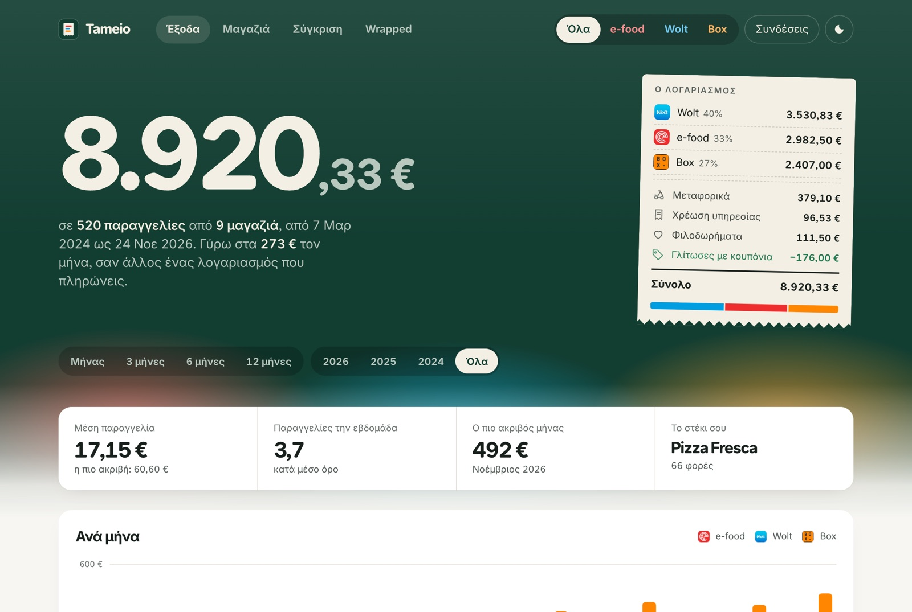
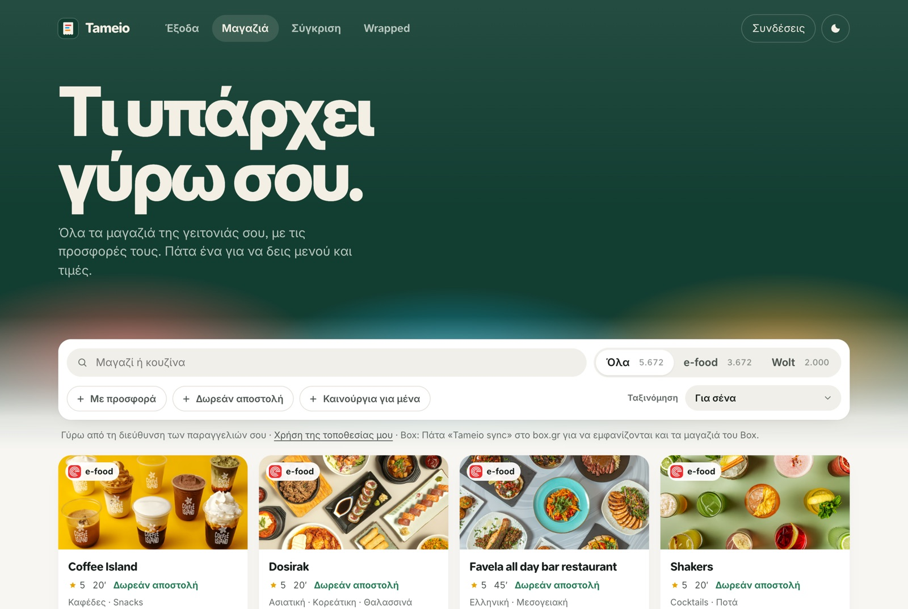
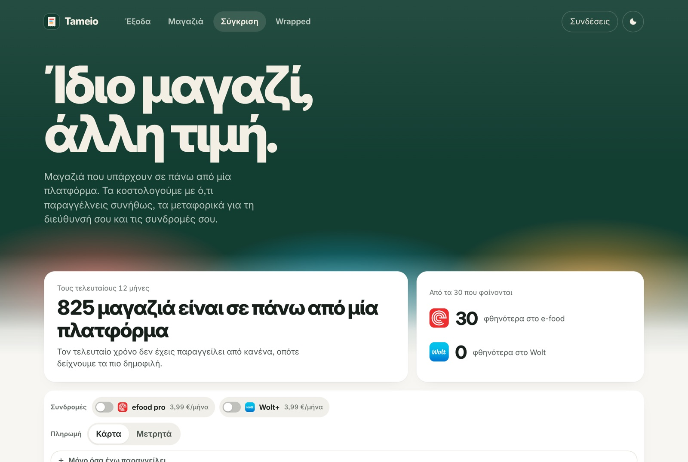
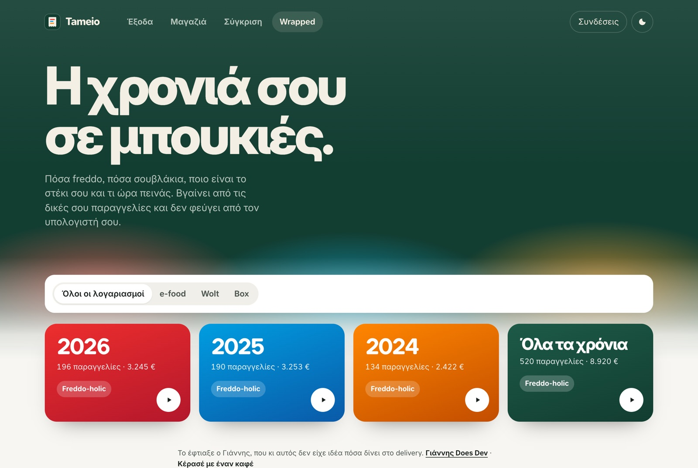

<div align="center">


# Tameio

**Πόσα δίνεις στο delivery;** Όλες οι παραγγελίες σου από **e-food**, **Wolt** και **Box** σε ένα σημείο, στον δικό σου υπολογιστή. Και για κάθε μαγαζί που είναι σε πάνω από μία πλατφόρμα, σου δείχνει πού βγαίνει φθηνότερα.

[](LICENSE)
[](https://nodejs.org)
[](package.json)
[](#-απόρρητο)

**Ελληνικά** · [English](README.en.md)

[Τι κάνει](#-τι-κάνει) · [Εγκατάσταση](#-εγκατάσταση) · [Με AI agent](#-με-ένα-ai-agent) · [Σύνδεση λογαριασμών](#-σύνδεση-λογαριασμών) · [Απόρρητο](#-απόρρητο) · [Συχνές ερωτήσεις](#-συχνές-ερωτήσεις) · [Συνεισφορά](#-συνεισφορά)



<table>
  <tr>
    <td width="33%"><a href="docs/screenshots/stores.jpg"></a></td>
    <td width="33%"><a href="docs/screenshots/compare.jpg"></a></td>
    <td width="33%"><a href="docs/screenshots/wrapped.jpg"></a></td>
  </tr>
  <tr>
    <td align="center"><b>Μαγαζιά</b><br><sub>Όλα τα μαγαζιά γύρω σου</sub></td>
    <td align="center"><b>Σύγκριση</b><br><sub>Πού βγαίνει φθηνότερα</sub></td>
    <td align="center"><b>Wrapped</b><br><sub>Η χρονιά σου σε μπουκιές</sub></td>
  </tr>
</table>

<sub>Τα στιγμιότυπα έχουν επινοημένες παραγγελίες. Τα μαγαζιά στα «Μαγαζιά» είναι οι δημόσιες λίστες των πλατφορμών.</sub>

</div>

---

## ✨ Τι κάνει

Οι εφαρμογές delivery σου δείχνουν κάθε παραγγελία χωριστά. Το Tameio τις βάζει όλες μαζί, από όλες τις πλατφόρμες, και σου λέει τι σημαίνουν.

| | |
| --- | --- |
| **Έξοδα** | Πόσα έδωσες συνολικά, ανά πλατφόρμα και ανά μήνα. Τι πήγε σε μεταφορικά, χρεώσεις υπηρεσίας και φιλοδωρήματα, και πόσα γλίτωσες με κουπόνια. Τα μαγαζιά και τα πιάτα που παίρνεις πιο συχνά, και πώς άλλαξαν οι τιμές τους. |
| **Μαγαζιά** | Όλα τα μαγαζιά γύρω σου από e-food, Wolt και Box σε μία λίστα, με φίλτρα για προσφορές, δωρεάν αποστολή και μαγαζιά που δεν έχεις δοκιμάσει. Πατάς ένα και βλέπεις το μενού του. |
| **Σύγκριση** | Μαγαζιά που υπάρχουν σε πάνω από μία πλατφόρμα, με τις τιμές τους πιάτο προς πιάτο και το τελικό ποσό σε κάθε πλατφόρμα, για να δεις πού σε συμφέρει. Δες [παρακάτω](#-πού-βγαίνει-φθηνότερα-το-ίδιο-μαγαζί). |
| **Wrapped** | Η χρονιά σου σε κάρτες: πόσα freddo, το στέκι σου, τι ώρα πεινάς, η πιο ακριβή παραγγελία. |

Επιπλέον: σκοτεινό θέμα, δουλεύει και στο κινητό, και φορτώνει μόνο ό,τι υπάρχει στο project (γραμματοσειρές και λογότυπα μαζί).

### 💸 Πού βγαίνει φθηνότερα το ίδιο μαγαζί

Πολλά μαγαζιά είναι και στο e-food και στο Wolt, κάποια και στο Box, αλλά δεν έχουν παντού τις ίδιες τιμές ούτε τις ίδιες χρεώσεις. Το Tameio βρίσκει ποια είναι το ίδιο μαγαζί (ίδιο όνομα, έως 400 μέτρα απόσταση) και σου δείχνει:

- **Τις τιμές πιάτο προς πιάτο.** Τα ίδια πιάτα από τα μενού του e-food και του Wolt δίπλα δίπλα, με σημειωμένο το φθηνότερο και τη διαφορά. Πρώτα έρχονται όσα παίρνεις εσύ, και από πάνω γράφει τη μέση διαφορά, π.χ. «στο Wolt φθηνότερα κατά 8%».
- **Πόσα θα πληρώσεις τελικά σε κάθε πλατφόρμα**, για την τελευταία σου παραγγελία από εκεί ή για ένα ποσό που βάζεις εσύ: τα πιάτα, τα μεταφορικά για τη διεύθυνσή σου, τη χρέωση υπηρεσίας και την ελάχιστη παραγγελία.
- **Με συνδρομή ή χωρίς.** Ανοίγεις το efood pro ή το Wolt+ και βλέπεις αμέσως πώς αλλάζει το ποσό. Διαλέγεις και κάρτα ή μετρητά, γιατί στο e-food η χρέωση υπηρεσίας μπαίνει μόνο με κάρτα.
- **Πόσα θα γλίτωνες.** Στη σελίδα «Σύγκριση» βλέπεις πόσα θα είχες γλιτώσει τους τελευταίους 12 μήνες αν διάλεγες κάθε φορά την πιο φθηνή πλατφόρμα, με τις σημερινές χρεώσεις.

Τα βλέπεις πατώντας ένα μαγαζί στα «Μαγαζιά» ή στη «Σύγκριση».

### Για ποιον είναι

- Για όποιον παραγγέλνει συχνά και θέλει να δει **πόσα δίνει πραγματικά** τον μήνα.
- Για όποιον έχει λογαριασμό **σε πάνω από μία πλατφόρμα** και θέλει να ξέρει πού βγαίνει φθηνότερα.
- Για όποιον θέλει τα στατιστικά του **χωρίς να τα δώσει σε κανέναν**: δεν υπάρχει λογαριασμός, cloud ή tracking.
- Για developers που θέλουν ένα μικρό, καθαρό project χωρίς εξαρτήσεις, για να το διαβάσουν, να το αλλάξουν ή να βάλουν κι άλλη πλατφόρμα.

## 🚀 Εγκατάσταση

Χρειάζεσαι μόνο [Node.js 20 ή νεότερο](https://nodejs.org). Δεν υπάρχει `npm install`: το Tameio δεν έχει εξαρτήσεις.

```bash
git clone https://github.com/yanispap/tameio.git
cd tameio
npm start
```

Το τερματικό γράφει μια διεύθυνση σαν **http://127.0.0.1:4321/#token=…**. Άνοιξέ την και πάτα **Συνδέσεις**. Το `#token` είναι το κλειδί αυτής της εγκατάστασης: το χρειάζεσαι μόνο την πρώτη φορά σε κάθε browser.

Για να το κλείσεις, πάτα `Ctrl+C` στο τερματικό. Οι παραγγελίες σου μένουν στον φάκελο `data/` για την επόμενη φορά.

<details>
<summary>Άλλο port</summary>

```bash
PORT=5000 npm start
```
</details>

### 🤖 Με ένα AI agent

Αν χρησιμοποιείς Claude Code, Codex, Cursor ή άλλον AI agent που τρέχει εντολές στον υπολογιστή σου, δώσ' του αυτό και θα κάνει την εγκατάσταση μόνος του:

```text
Εγκατάστησε μου το Tameio από το https://github.com/yanispap/tameio
ακολουθώντας τις οδηγίες του AGENTS.md, ξεκίνα το και πες μου πώς να συνδέσω τους λογαριασμούς μου.
```

Ο agent ελέγχει το Node.js, κατεβάζει τον κώδικα, τρέχει τα tests, ξεκινάει το Tameio και ανοίγει τη σελίδα. Οι οδηγίες που ακολουθεί είναι στο [`AGENTS.md`](AGENTS.md). Μία από αυτές: δεν ζητάει ποτέ κωδικούς ή tokens. Τους λογαριασμούς σου τους συνδέεις εσύ, στη σελίδα του Tameio.

## 🔗 Σύνδεση λογαριασμών

Κάθε χρήστης συνδέει **τους δικούς του** λογαριασμούς. Το Tameio δεν έχει μέσα κανέναν λογαριασμό, κλειδί ή token.

| Πλατφόρμα | Πώς | Τι κρατάει |
| --- | --- | --- |
| **e-food** | Γράφεις email και κωδικό στις **Συνδέσεις**. Πηγαίνουν μόνο στο e-food, μέσω του server στον υπολογιστή σου. Μετά, η **Ανανέωση** φέρνει τις νέες παραγγελίες με ένα κλικ. | Τη σύνδεση (session), για τα μενού και την Ανανέωση. Ποτέ τον κωδικό. |
| **Wolt** | Σέρνεις το κουμπί **Tameio sync** στους σελιδοδείκτες, ανοίγεις το wolt.com συνδεδεμένος και το πατάς. | Τίποτα. Προαιρετικά, αυτόματος συγχρονισμός με το cookie `__wtoken`. |
| **Box** | Το ίδιο κουμπί **Tameio sync**, πατημένο στο box.gr αφού έχεις διαλέξει διεύθυνση. | Τα μαγαζιά της περιοχής σου, για τα «Μαγαζιά». |
| **Οποιαδήποτε** | Ανεβάζεις ένα αρχείο JSON με τη λίστα παραγγελιών (π.χ. από το Proxyman). Το Tameio καταλαβαίνει μόνο του από πού είναι. | Μόνο τις παραγγελίες. |

> [!TIP]
> Το **Tameio sync** τρέχει μέσα στη σελίδα του wolt.com ή του box.gr, με τη σύνδεση που ήδη έχεις εκεί, και στέλνει τις παραγγελίες στο Tameio. Δεν αντιγράφεις τίποτα. Ο κώδικάς του είναι στο [`public/lib/bookmarklet.js`](public/lib/bookmarklet.js).

## 🔒 Απόρρητο

Όλα τρέχουν στον υπολογιστή σου. Δεν υπάρχει server του Tameio, analytics, tracking ή κλήσεις «προς τα πίσω». Ο server ακούει μόνο στο `127.0.0.1`, απορρίπτει αιτήματα από άλλες ιστοσελίδες, και θέλει το κλειδί αυτής της εγκατάστασης, ώστε ούτε άλλα προγράμματα στον υπολογιστή να μη διαβάζουν τις παραγγελίες σου.

> [!WARNING]
> Μη βάλεις τον φάκελο του Tameio σε iCloud, Dropbox, Google Drive ή άλλο φάκελο που συγχρονίζεται. Ο φάκελος `data/` έχει τις συνδέσεις σου στο e-food και στο Wolt.

<details>
<summary><b>Πού συνδέεται το Tameio</b></summary>

| Προς | Γιατί | Με τι |
| --- | --- | --- |
| `www.e-food.gr/users/login` | σύνδεση στο e-food | το email και τον κωδικό σου, μία φορά |
| `api.e-food.gr` | παραγγελίες, μαγαζιά της περιοχής, μενού | τη σύνδεσή σου (session) |
| `consumer-api.wolt.com`, `restaurant-api.wolt.com` | παραγγελίες, μαγαζιά, μενού, χρεώσεις μαγαζιού | δημόσια, ή με τη σύνδεσή σου αν ενεργοποιήσεις τον αυτόματο συγχρονισμό |
| `authentication.wolt.com` | ανανέωση της σύνδεσης Wolt | μόνο αν ενεργοποιήσεις τον αυτόματο συγχρονισμό |

Στα «Μαγαζιά» και στη «Σύγκριση», ο browser φορτώνει τις φωτογραφίες των μαγαζιών απευθείας από e-food, Wolt και Box, όπως και στα δικά τους site.

Το **Box** δεν το καλεί ποτέ ο server του Tameio: απαντάει μόνο στη δική του εφαρμογή και στο site του. Το Tameio sync κρατάει τις απαντήσεις που φορτώνει το ίδιο το box.gr.
</details>

<details>
<summary><b>Τι αποθηκεύεται</b></summary>

Μόνο στον φάκελο `data/` του υπολογιστή σου, που δεν μπαίνει ποτέ στο git:

| Αρχείο | Περιεχόμενο |
| --- | --- |
| `orders.json` | οι παραγγελίες σου, σε απλή μορφή |
| `efood-session.json` | η σύνδεση του e-food (όχι ο κωδικός), για τα μενού και την Ανανέωση |
| `wolt-session.json` | η σύνδεση του Wolt, μόνο αν ενεργοποιήσεις τον αυτόματο συγχρονισμό |
| `box-shops.json` | τα μαγαζιά του Box που έφερε το Tameio sync |
| `location.json` | το σημείο γύρω από το οποίο ψάχνουμε μαγαζιά, αν πάτησες «Χρήση της τοποθεσίας μου» |
| `token` | το κλειδί αυτής της εγκατάστασης για τον τοπικό server |

Σβήνεις τον φάκελο `data/` και όλα φεύγουν.
</details>

> [!IMPORTANT]
> **Δεν έχουμε καμία σχέση με τις e-food, Wolt και Box** και δεν εγκρινόμαστε από αυτές. Το Tameio διαβάζει μόνο το δικό σου ιστορικό, με τη δική σου σύνδεση. Οι όροι κάποιων υπηρεσιών περιορίζουν την αυτοματοποιημένη πρόσβαση: οι [όροι του Wolt](https://explore.wolt.com/el/grc/terms) (§12.6) απαγορεύουν ρομπότ και αυτοματοποιημένες μεθόδους και το Wolt μπορεί να αφαιρέσει χρήστες (§12.7). Οι [όροι του e-food](https://www.e-food.gr/page/tos) δίνουν «προσωπικό, περιορισμένο» δικαίωμα πρόσβασης. Τους [όρους του Box](https://box.gr/terms) διάβασέ τους εσύ. Αν θα το χρησιμοποιήσεις στον λογαριασμό σου είναι δική σου απόφαση και ευθύνη.

## ❓ Συχνές ερωτήσεις

<details>
<summary><b>Πληρώνω κάτι;</b></summary>

Όχι. Το Tameio είναι δωρεάν, ανοιχτού κώδικα (MIT) και χωρίς διαφημίσεις.
</details>

<details>
<summary><b>Βλέπει κανείς τις παραγγελίες ή τους κωδικούς μου;</b></summary>

Όχι. Δεν υπάρχει server του Tameio στο ίντερνετ. Οι παραγγελίες μένουν στον φάκελο `data/` του υπολογιστή σου και ο κωδικός του e-food χρησιμοποιείται μία φορά για τη σύνδεση και δεν γράφεται πουθενά. Μπορείς να το ελέγξεις: όλος ο κώδικας είναι εδώ, χωρίς εξαρτήσεις.
</details>

<details>
<summary><b>Χρειάζεται να ξέρω προγραμματισμό;</b></summary>

Λίγο τερματικό μόνο: εγκαθιστάς το Node.js, γράφεις τις τρεις εντολές της [εγκατάστασης](#-εγκατάσταση) και από εκεί και πέρα όλα γίνονται στον browser.
</details>

<details>
<summary><b>Δουλεύει σε Windows, macOS και Linux;</b></summary>

Ναι, όπου τρέχει Node 20+. Ο browser μπορεί να είναι οποιοσδήποτε σύγχρονος (Chrome, Safari, Firefox, Edge).
</details>

<details>
<summary><b>Πώς φέρνω τις νέες παραγγελίες;</b></summary>

Στις **Συνδέσεις**:

- **e-food:** πατάς **Ανανέωση**. Με ένα κλικ φέρνει τις νέες, με τη σύνδεση που κράτησε την πρώτη φορά. Αν η σύνδεση έχει λήξει, σου ζητάει ξανά email και κωδικό.
- **Wolt:** πατάς **Tameio sync** ενώ είσαι στο wolt.com. Αν άνοιξες τον αυτόματο συγχρονισμό, τις φέρνει μόνο του όταν ανοίγεις το Tameio.
- **Box:** πατάς **Tameio sync** ενώ είσαι στο box.gr.

Οι νέες παραγγελίες προστίθενται στις παλιές, χωρίς διπλές.
</details>

<details>
<summary><b>Γιατί λείπουν κάποιες παλιές παραγγελίες;</b></summary>

Εξαρτάται από την πλατφόρμα. Το **Box** δίνει μόνο τις τελευταίες 100 παραγγελίες. Το Tameio κρατάει όσες έχει ήδη φέρει, οπότε αν συγχρονίζεις που και που, το ιστορικό σου μεγαλώνει χωρίς κενά. Το **Wolt** δεν δίνει στη λίστα τα μεταφορικά και τα φιλοδωρήματα, οπότε αυτά τα ποσά δείχνουν μόνο ό,τι είναι γνωστό.
</details>

<details>
<summary><b>Θα μου κλείσουν τον λογαριασμό;</b></summary>

Το Tameio διαβάζει μόνο το δικό σου ιστορικό, με τον ρυθμό που θα το έκανες κι εσύ στο site. Οι όροι όμως κάποιων πλατφορμών απαγορεύουν τα αυτοματοποιημένα εργαλεία (δες το πλαίσιο στο [Απόρρητο](#-απόρρητο)). Ο αυτόματος συγχρονισμός του Wolt είναι προαιρετικός και κλειστός από προεπιλογή.
</details>

<details>
<summary><b>Σταμάτησε να φέρνει παραγγελίες. Τι κάνω;</b></summary>

Οι πλατφόρμες αλλάζουν συχνά τα site τους. Πάτα ξανά **Ανανέωση** στις Συνδέσεις και, αν δεν δουλέψει, [άνοιξε ένα issue](../../issues/new/choose) με το μήνυμα που βλέπεις (χωρίς tokens ή προσωπικά στοιχεία).
</details>

<details>
<summary><b>Μπορώ να προσθέσω κι άλλη πλατφόρμα;</b></summary>

Ναι, και θα χαρούμε. Δες το [CONTRIBUTING.md](CONTRIBUTING.md): κάθε πλατφόρμα χρειάζεται μόνο έναν τρόπο να φέρει τις παραγγελίες και μια συνάρτηση στο [`public/lib/normalize.js`](public/lib/normalize.js) που τις μετατρέπει στην κοινή μορφή.
</details>

<details>
<summary><b>Πώς σβήνω όλα μου τα δεδομένα;</b></summary>

Σβήσε τον φάκελο `data/`. Αυτό ήταν.
</details>

## 🤝 Συνεισφορά

Το Tameio είναι ανοιχτό σε ιδέες και βελτιώσεις. Μπορείς να:

- **Κάνεις fork** και να το προσαρμόσεις όπως θέλεις. Η άδεια MIT το επιτρέπει.
- **Ανοίξεις ένα [issue](../../issues/new/choose)** για ένα πρόβλημα ή μια ιδέα.
- **Στείλεις pull request.** Ξεκίνα από το [CONTRIBUTING.md](CONTRIBUTING.md): πώς τρέχει, πώς είναι οργανωμένος ο κώδικας και τι ελέγχουμε πριν το merge.

<details>
<summary><b>Δομή του κώδικα</b></summary>

```
server.js                τοπικός server: συνδέσεις, παραγγελίες, μαγαζιά, μενού, αποθήκευση
public/index.html        το dashboard
public/app.js, app.css   Έξοδα, Συνδέσεις, κοινό στυλ
public/stores.js         Μαγαζιά
public/compare-ui.js     Σύγκριση
public/wrapped-ui.js     Wrapped
public/lib/normalize.js  κοινή μορφή παραγγελίας για όλες τις πλατφόρμες
public/lib/stats.js      στατιστικά
public/lib/bookmarklet.js  το Tameio sync
test.mjs                 npm test
```
</details>

## 💛 Ποιος το έφτιαξε

Ο Γιάννης, γιατί κι εκείνος δεν ήξερε πόσα δίνει στο delivery: [yannisdoes.dev](https://yannisdoes.dev).

Αν σου φάνηκε χρήσιμο, μπορείς να με [κεράσεις έναν καφέ](https://buymeacoffee.com/yannispap) ☕. Ένα ⭐ στο repo βοηθάει κι αυτό.

## 🙏 Ευχαριστίες

Το Tameio δεν θα υπήρχε χωρίς δύο projects ανοιχτού κώδικα, που άνοιξαν τον δρόμο:

- **[efood-analytics](https://github.com/eliac7/efood-analytics)** του Ilias Nikolaos Thalassochoritis (MIT): η σύνδεση στο e-food και το ιστορικό παραγγελιών.
- **[wolt-insights](https://github.com/PolovinaD/wolt-insights)** του Dušan Polovina (MIT): τα endpoints του Wolt και η ιδέα για τα Wrapped, τις τιμές και τα μενού.

Οι άδειες και τα copyright τους είναι στο [`NOTICE`](NOTICE).

Γραμματοσειρές: [Allo](https://github.com/joshpuckett/allo) και, για τα ελληνικά, [Inter](https://github.com/rsms/inter) 4.1, και οι δύο με άδεια SIL OFL 1.1 (στον φάκελο `public/fonts/`). Τα λογότυπα στο `public/logos/` είναι εμπορικά σήματα των e-food, Wolt και Box και χρησιμοποιούνται μόνο για να φαίνεται σε ποια υπηρεσία αναφέρεται κάθε επιλογή.

## 📄 Άδεια

[MIT](LICENSE). Κάνε το ό,τι θέλεις, κράτα μόνο το copyright.
